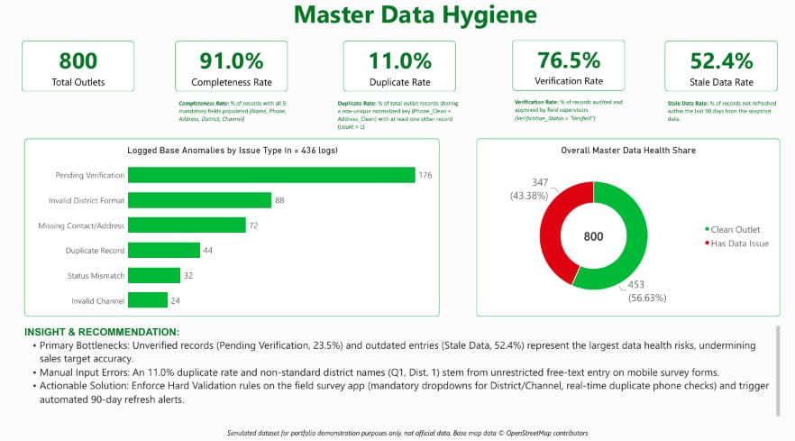
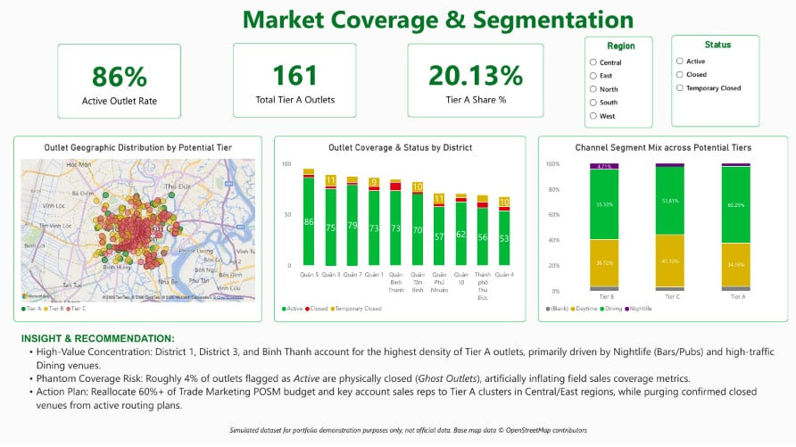
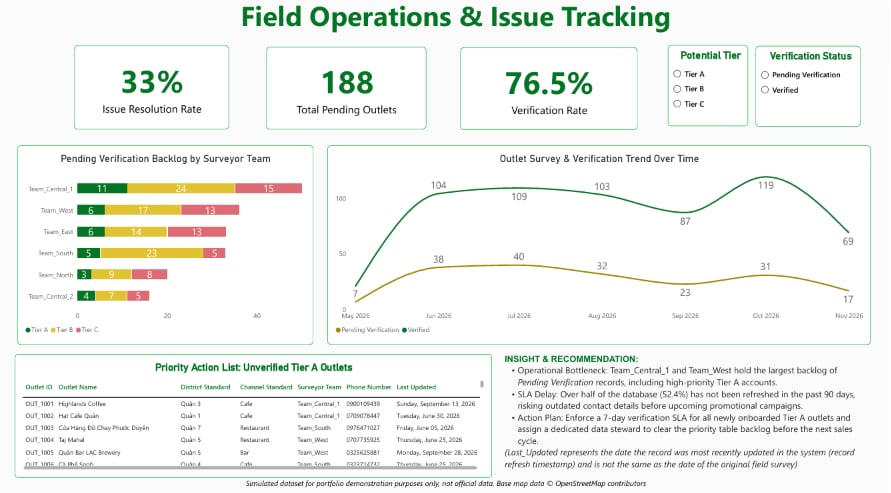

# fmcg-trade-census-master-data-analytics
End-to-end BI portfolio project simulating an 800-outlet HCMC Trade Census: Python data simulation, Power Query master data cleansing, DAX KPIs, and Power BI coverage &amp; operations tracking.
# FMCG Trade Census Master Data Hygiene & Market Coverage Analytics (Ho Chi Minh City)

> **⚠️ DISCLAIMER:** This is a **simulated dataset** created strictly for portfolio demonstration and analytical showcase purposes. **It does NOT represent official data, commercial metrics, or standard SLAs* or any specific FMCG organization. Base venue names and geographic coordinates are sourced from OpenStreetMap (**© OpenStreetMap contributors**).

---

## 1. Business Problem & Project Objectives

In Fast-Moving Consumer Goods (FMCG) commercial operations, a reliable **Trade Census (Outlet Master Data)** underpins route-to-market planning, territory coverage analysis, and field execution. However, manually collected outlet databases often degrade due to duplicate entries, non-standard administrative naming, missing contact fields, and unverified or outdated records.

This end-to-end BI project simulates an **800-record On-Premise Trade Census** in Ho Chi Minh City (evaluated against a fixed snapshot date of **November 21, 2026**) to demonstrate three core analytical workflows:
1. **Master Data Hygiene (Page 1):** Quantify master data quality using automated Power Query validation rules and isolate anomalies before downstream reporting.
2. **Market Coverage & Segmentation (Page 2):** Demonstrate how standardized district, channel segment (*Nightlife, Dining, Daytime*), and simulated potential tiers (*Tier A/B/C*) can structure outlet coverage analysis.
3. **Field Operations & Issue Tracking (Page 3):** Illustrate an operational monitoring workflow tracking simulated verification backlogs by surveyor team, record refresh latency, and prioritized follow-up lists.

---

## 2. Tech Stack & Workflow

* **Data Extraction & Simulation (`Python`):** Retrieved Ho Chi Minh City F&B venue data from OpenStreetMap via Overpass API (`fetch_osm.py`), then generated synthetic operational attributes and controlled data quality scenarios (`generate_census.py`) for portfolio analysis.
* **ETL & Cleansing (`Power Query / M`):** Standardized district names via a lookup mapping table, normalized phone/address strings, identified multi-record duplicates via grouped composite keys (`Phone_Clean + Address_Clean`), and engineered binary anomaly flags.
* **Data Modeling & Analytics (`Power BI & DAX`):** Built a relational model connecting the cleaned `Outlets` master table with `Dim_District`, `Dim_Channel`, `Calendar`, and `Data_Issue_Log`, backed by explicit DAX measures anchored to a fixed snapshot date.

---

## 3. Data Lineage, Sampling & Schema

### 3.1. Data Lineage & Sampling Methodology
* **OpenStreetMap Base Extract (`osm_raw.csv` — 3,192 raw venues):** Queried real Ho Chi Minh City venues (`restaurant`, `cafe`, `bar`, `pub`) with non-null names and coordinates via Overpass API. **© OpenStreetMap contributors** (ODbL).
* **Sampling Logic (3,192 raw $\rightarrow$ 800 simulated records):** After deduplicating raw OSM records on `(name, lat, lon)`, **756 unique venues** were randomly sampled (`random_state=42`) to serve as the base dataset. Subsequently, **44 records** were intentionally duplicated with whitespace variations to produce an exact **800-record raw input file** (`Outlets_Raw_Dirty.csv`).
* **Synthetic Attributes (100% Generated via Python):** `Outlet_ID`, `Phone`, `Status`, `Verification_Status`, `Data_Source`, `Surveyor_Team`, `Potential_Tier` (assigned via weighted probabilities: 20% Tier A, 50% Tier B, 30% Tier C), `Last_Updated` (system record refresh timestamp), `Data_Issue_Log.csv`, and all `Dim_*` lookup tables.

### 3.2. Data Model Overview

| Table Name | Role | Key Columns | Description |
| :--- | :--- | :--- | :--- |
| **`Outlets`** | Core Outlet Master Table (800 rows) | `Outlet_ID`, `Outlet_Name`, `Channel`, `District_Clean`, `Phone_Clean`, `Address_Clean`, `Status`, `Verification_Status`, `Surveyor_Team`, `Potential_Tier`, `Last_Updated`, `Is_Missing`, `Is_Duplicate`, `Is_Invalid_Channel`, `Is_Status_Mismatch` | Core entity master table storing normalized outlet attributes and binary data quality flags. |
| **`Data_Issue_Log`** | Event / Audit Log Table | `Log_ID`, `Outlet_ID`, `Issue_Type`, `Description`, `Detected_Date`, `Resolved_Status` | Event-level audit log recording seeded anomalies and simulated resolution statuses. |
| **`Dim_District`** | Lookup / Dimension | `District_ID`, `District_Standard`, `Region` | Standardized 10 HCMC districts grouped into 5 regions (*Central, East, North, South, West*). |
| **`Dim_Channel`** | Lookup / Dimension | `Channel_ID`, `Channel_Standard`, `Segment` | Rule-based mapping of channels (*Bar, Pub* $\rightarrow$ *Nightlife*; *Restaurant* $\rightarrow$ *Dining*; *Cafe* $\rightarrow$ *Daytime*). |
| **`Calendar`** | Date Dimension | `Date`, `Year`, `Month` | Dynamic DAX date table linked to `Outlets[Last_Updated]`. |

### 3.3. Seeded Data Anomalies & Reconciliation Notes
To simulate realistic data cleansing scenarios, controlled anomalies were injected into `Outlets_Raw_Dirty.csv`:

| Anomaly Type | Seeded Count & Share | Notes & Cleansing Logic in Power Query |
| :--- | :---: | :--- |
| **Pending Verification** | **188 rows (23.5%)** in `Outlets` *(176 base logs in `Data_Issue_Log`)* | 176 base records were assigned `Pending Verification`; 12 of these were subsequently duplicated during duplicate injection, resulting in 188 total pending rows in `Outlets`. |
| **Non-Standard District Format** | **88 rows (11.0%)** | Variants (*Q1, Dist. 1, quận 1, Binh Thanh*) standardized via `District_Mapping`. |
| **Missing Contact / Address** | **72 rows (9.0%)** | Flagged via `Is_Missing` when any mandatory field (*Name, Phone, Address, District, Channel*) is null/blank. |
| **Duplicate Records** | **88 rows (11.0%)** | 44 base outlets duplicated (resulting in 88 non-unique rows). Logic (`Dup_Count > 1` on `Phone_Clean + Address_Clean`) scales to detect 2, 3, or $N$ duplicate entries per outlet. |
| **Status Mismatch (Ghost Outlets)** | **32 rows (4.0%)** | Flagged via `Is_Status_Mismatch` where venue name indicates closure while `Status = "Active"` (distinct from 90-day record staleness). |
| **Invalid Channel Category** | **24 rows (3.0%)** | Unmapped categories (*Bistro, Beer Club, Street Food*) flagged via `Is_Invalid_Channel`. |

---

## 4. KPI Definitions & DAX Formulas

All rates use total rows in `Outlets` (**800 records**) as the denominator unless filtered by slicers. Record staleness is evaluated against a fixed **Snapshot Date (`2026-11-21`)**:

| KPI Name | Business Definition | DAX Formula |
| :--- | :--- | :--- |
| **Total Outlets** | Total records in the `Outlets` master table. | `COUNTROWS(Outlets)` |
| **Completeness Rate** | % of records with all 5 mandatory fields populated (*Name, Phone, Address, District, Channel*). | `DIVIDE(CALCULATE(COUNTROWS(Outlets), Outlets[Is_Missing] = FALSE()), COUNTROWS(Outlets))` |
| **Duplicate Rate** | % of total records sharing a non-unique normalized key (`Phone_Clean + Address_Clean`, count > 1). | `DIVIDE(CALCULATE(COUNTROWS(Outlets), Outlets[Is_Duplicate] = TRUE()), COUNTROWS(Outlets))` |
| **Verification Rate** | % of records audited and marked as `Verified` (`1 - 23.5% Pending = 76.5%`). | `DIVIDE(CALCULATE(COUNTROWS(Outlets), Outlets[Verification_Status] = "Verified"), COUNTROWS(Outlets))` |
| **Stale Data Rate** | % of records whose system refresh timestamp (`Last_Updated`) is >90 days prior to `2026-11-21`. | `VAR SnapshotDate = DATE(2026, 11, 21) RETURN DIVIDE(CALCULATE(COUNTROWS(Outlets), DATEDIFF(Outlets[Last_Updated], SnapshotDate, DAY) > 90), COUNTROWS(Outlets))` |
| **Active Outlet Rate** | % of records with `Status = "Active"`. | `DIVIDE(CALCULATE(COUNTROWS(Outlets), Outlets[Status] = "Active"), COUNTROWS(Outlets))` |
| **Tier A Share %** | % of records assigned `Potential_Tier = "Tier A"`. | `DIVIDE(CALCULATE(COUNTROWS(Outlets), Outlets[Potential_Tier] = "Tier A"), COUNTROWS(Outlets))` |
| **Issue Resolution Rate** | % of logged anomalies in `Data_Issue_Log` marked as `Resolved`. | `DIVIDE(CALCULATE(COUNTROWS(Data_Issue_Log), Data_Issue_Log[Resolved_Status] = "Resolved") + 0, COUNTROWS(Data_Issue_Log))` |

---

## 5. Dashboard Preview & Analytical Commentary

### Page 1: Master Data Hygiene

* **Observations:** Clean master data accounts for **56.6%** (453/800 records). *Stale Data* (52.4%) and *Pending Verification* (23.5% across `Outlets`; 176 base audit logs) represent the largest data quality gaps.
* **Analytical Commentary:** The simulated dataset contains duplicate records (11.0%) and non-standard district formats (11.0%), illustrating potential data quality issues that may arise from unrestricted free-text input. Left unaddressed, stale and unverified records may affect the reliability of outlet master data and could create challenges for downstream sales planning.
* **Proposed Controls:** Implement dropdown validation for District/Channel fields and real-time duplicate key checks on data capture forms, paired with automated 90-day record refresh reminders.

### Page 2: Market Coverage & Segmentation

* **Observations:** Across the simulated dataset, Tier A outlets (~20.1% overall share) appear concentrated in central and eastern districts (*District 1, District 3, Binh Thanh*) and within rule-mapped *Nightlife* and *Dining* segments. Roughly 4.0% of active records exhibit closed/active status mismatches (`Is_Status_Mismatch`).
* **Analytical Commentary:** The simulated segmentation shows a concentration of Tier A outlets in selected districts and channel segments. These patterns demonstrate how outlet segmentation can support coverage analysis, but **do not represent verified commercial potential** (as tiers were synthetically generated without underlying sales volume data).
* **Analytical Commentary:** The simulated segmentation shows a concentration of Tier A outlets in selected districts and channel segments. These patterns demonstrate how outlet segmentation can support coverage analysis, but do not represent verified commercial potential (as tiers were synthetically generated without underlying sales volume data).
* **Next Steps for Business Application:** Further validation with actual sales performance, outlet volume potential, and Trade Marketing investment data would be required before making POSM or key account resource allocation decisions.

### Page 3: Field Operations & Issue Tracking

* **Observations:** Within the simulated operational dataset, Team_Central_1 has the largest pending verification backlog (50 records, including 11 Tier A outlets), followed by Team_West (36 records, including 6 Tier A outlets). The overall issue resolution rate is 33.3%, calculated from the simulated Data_Issue_Log. Monthly record refresh trends (May–November 2026) track verification progress across all 800 records.
* **Analytical Commentary:** Monitoring pending verification records by surveyor team and potential tier helps illustrate how an operations team could identify workload concentration and prioritize follow-up activities, alongside a prioritized action table of unverified Tier A outlets.
* **Proposed Monitoring Rule:** A conceptual 7-day verification target could be introduced for pending Tier A outlets. This is a proposed portfolio governance benchmark, not an official HEINEKEN SLA. Actual SLA monitoring would require reliable verification request and completion timestamps.

## 6. Repository Structure

text ├── data/ │   ├── osm_raw.csv                   # Raw OpenStreetMap venue extract (3,192 venues) │   ├── Outlets_Raw_Dirty.csv         # Simulated 800-record dataset with seeded anomalies │   ├── Data_Issue_Log.csv            # Event-level anomaly audit log │   ├── Dim_District.csv              # District & Region lookup table │   └── Dim_Channel.csv               # Channel & Segment lookup table ├── scripts/ │   ├── fetch_osm.py                  # Python script querying Overpass API │   └── generate_census.py            # Python script for sampling, synthetic attributes & anomaly injection ├── images/ │   ├── page1_master_data_hygiene.png │   ├── page2_market_coverage.png │   └── page3_field_operations.png ├── Trade_Census_Master_Data.pbix     # Power BI Desktop report file ├── Trade_Census_Dashboard_3Pages.pdf # Exported 3-page PDF for quick viewing └── README.md                         # Project documentation 

## 7. Project Limitations & Future Improvements

* **Synthetic Operational & Commercial Attributes:** Potential_Tier, Status, Verification_Status, and Last_Updated are synthetically generated. In a production environment, outlet tiering should be driven by actual sell-in/sell-out volume data from DMS/ERP systems.
* **Record Refresh vs. Field Visit Date:** Last_Updated models system record modification timestamps rather than verified GPS check-in dates from field visits, and the dataset does not track request submission timestamps required for formal SLA auditing.
* **Advanced Deduplication:** Current duplicate detection uses exact composite key matching (Phone_Clean + Address_Clean). Future iterations can integrate fuzzy string matching (e.g., Levenshtein distance) to detect near-duplicate venue names with minor spelling variations.

## 8. License & Attribution

* **OpenStreetMap Data:** Base venue data is © OpenStreetMap contributors and available under the Open Database License (ODbL). See OpenStreetMap Copyright and License.
* **Original Code:** Original project Python scripts (fetch_osm.py, generate_census.py) are released under the MIT License.
* **Project Outputs:** The MIT License applies to original documentation, Power Query/DAX logic, and dashboard design created for this portfolio project, subject to upstream ODbL attribution requirements for derived geographic data.
